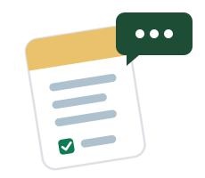
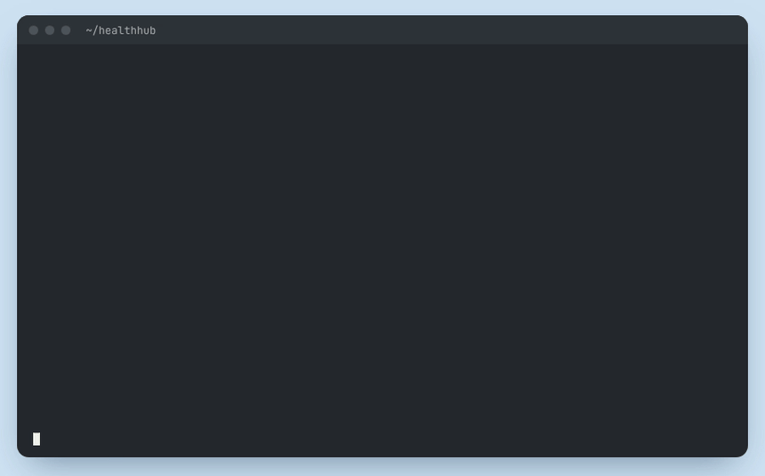

<p align="center"></p>

# the-lowdown

**Give your AI agent the lowdown.** A short guided Q&A that writes a design brief (users, goals, constraints, tone) your agent can follow.

[](https://www.npmjs.com/package/@pixelatlarge/the-lowdown)

**[Try it in your browser →](https://pixelatlarge.github.io/the-lowdown/)** No install, and nothing leaves your browser unless you share the link.

https://github.com/user-attachments/assets/664fe32c-e3d6-4107-a590-d4331334f937

Agents fill gaps with generic defaults: everyone is the user, every feature is in scope, and the tone is "clean and modern". A few minutes of answering the right questions up front stops a lot of rework. `the-lowdown` asks those questions, pushes back on weak answers, and writes a brief in a shape agents follow well:

- **Hard requirements vs. guidance.** Must-include, must-avoid and accessibility items are labelled as non-negotiable; out-of-scope items as do-not-build.
- **Tone becomes instructions.** Pick "calm, warm, playful" and the brief spells out what each means in practice (do / avoid), so the agent isn't left to interpret adjectives.
- **Fidelity sets the bar.** Sketch, prototype or production, so the agent doesn't polish a sketch or sketch a release.
- **A definition of done.** A checklist built from your goals and constraints that the agent can verify against.
- **Quality checks.** Flags "everyone" as a user, adjective-only goals ("intuitive"), empty scope limits and conflicting tone words before you hand it over.

Zero runtime dependencies. Node 18.17+.

## Quick start

Run it without installing, or install it globally to get the `the-lowdown` command:

```sh
npx @pixelatlarge/the-lowdown            # 21–25 questions, writes BRIEF.md
npx @pixelatlarge/the-lowdown --quick    # 11–12 essential questions

npm i -g @pixelatlarge/the-lowdown
the-lowdown
```



Then point your agent at it:

```sh
npx @pixelatlarge/the-lowdown link      # or add --link when you create the brief
```

This adds a short "follow BRIEF.md" block to the agent instruction files you already have: `CLAUDE.md`, `AGENTS.md`, Cursor rules or Copilot instructions. If you have none, it creates `AGENTS.md`. Running it again updates the block instead of adding another, and nothing else in those files is touched. Pick files explicitly with `--link-to claude,cursor`.

While answering: **Enter** skips an optional question (or accepts the default), **`<`** goes back, **`?`** explains why a question matters. Choices are arrow-key menus: **↑↓** to move, **space** to pick, **enter** to confirm. Prefer typing? `--plain` takes numbers (`1,3`), labels, or your own words instead, and so does any piped input.

## What it asks

| Section | Questions |
| --- | --- |
| Project | Name\*, summary\*, kind, fidelity |
| Specifics | Two or three questions for the kind of project (below) |
| Users | Primary user\*, situation, secondary users, accessibility |
| Goals | Success criteria\*, goal ranking (with two or more goals), primary action, out of scope |
| Constraints | Platforms, stack / design system, real content available?, brand assets, things that apply everywhere (dark mode, localization…), must include, must avoid |
| Tone | Up to three tone words, references and what to borrow from each, "never feel like" |

### Questions by project type

Asked only when the project kind matches, so the interview stays short.

| Kind | Asks about |
| --- | --- |
| Web app | Key flows, start to finish |
| Marketing site | The conversion goal, where visitors come from, real proof points |
| Mobile app | Offline needs, one-handed use, native vs. shared design |
| Dashboard | The numbers that matter most, data density (1–5 scale), data freshness |
| Components | Which components, where the design tokens live, usage docs |
| Content | Format and size, where it will appear |

Ranked goals come out as a numbered list ("when two conflict, the higher one wins"). "No content yet" tells the agent to write realistic copy and never invent quotes or numbers. References written as `Headspace — the calm pacing` come out as "borrow the calm pacing", and the brief check nudges you when a reference has nothing to borrow.

\* required

## CLI

```
the-lowdown [init] [options]     Run the guided Q&A (default)
the-lowdown edit [brief]         Re-run the Q&A on an existing brief, current answers prefilled
the-lowdown diff <old> <new>     Show what changed between two briefs (exit 1 if they differ)
the-lowdown render <file>        Render a BRIEF.md, brief JSON or answers JSON file
the-lowdown lint <file>          Check a brief and score its strength (exit 1 on warnings)
the-lowdown questions            Print the question schema as JSON (for agents)
the-lowdown link [brief]         Point CLAUDE.md / AGENTS.md / Cursor rules at a brief

-o, --out <file>          Output file. Default: BRIEF.md for init, stdout for render. "-" = stdout
-f, --format <fmt>        markdown | prompt | json | html  (default: from --out extension; pdf = html)
-q, --quick               Essential questions only
    --answers <file>      Prefill from JSON; only missing questions are asked
    --config <file>       Team config (default: .lowdownrc.json, .lowdownrc or lowdown.config.json)
    --plain               Type numbers instead of using arrow-key menus
    --save-answers <file> Also save raw answers (edit and re-render later)
    --no-instructions     Leave out the "How to use this brief" section
    --no-checklist        Leave out the definition-of-done checklist
    --no-frontmatter      Leave out the small YAML header in Markdown files
    --only <list>         edit: re-ask just these sections or question ids (e.g. goals,tone)
    --link                After writing, point your agent instruction files at the brief
    --link-to <list>      claude, agents, cursor, copilot (default: whichever exist, else AGENTS.md)
-y, --yes                 Don't ask before writing or overwriting
```

| `--link-to` | File |
| --- | --- |
| `claude` | `CLAUDE.md` |
| `agents` | `AGENTS.md` |
| `cursor` | `.cursor/rules/the-lowdown.mdc` (always-applied rule) |
| `copilot` | `.github/copilot-instructions.md` |

### Edit, diff and score a brief

`BRIEF.md` is the source of truth. Edit it by hand, and every command reads it back: `render`, `lint`, `diff` and `edit` take a `BRIEF.md`, a brief JSON or an answers JSON. Markdown files get a short YAML header (`brief`, `schema`, `project`, `created`) so tools can spot them; the body is what's read.

```sh
the-lowdown edit                      # walk through BRIEF.md again; Enter keeps each answer
the-lowdown edit --only goals,tone    # re-ask just those sections, keep the rest as is
the-lowdown diff v1.md BRIEF.md       # what changed, field by field
the-lowdown lint BRIEF.md             # warnings, tips and a strength score
```

`edit` shows the changes and the review before it writes, and keeps the brief's original date. `diff` exits 1 when the briefs differ, so it works as a CI check.

The **strength score** (0–100, Thin / Okay / Strong / Excellent) appears in the review step and in `lint`. It counts a specific primary user, measurable and ranked goals, scope, a primary action, a clear tone, fidelity, constraints, accessibility, context and project specifics, minus points for each warning, then names the two changes that would add the most.

### Team config

Put a `.lowdownrc.json` in your project (or pass `--config`) to give everyone the same setup. Every field is optional, and command-line flags win.

```json
{
  "quick": true,
  "out": "docs/BRIEF.md",
  "link": ["claude", "cursor"],
  "answers": { "stack": "React + Tailwind; use @acme/ui components first" },
  "defaults": { "platforms": ["Mobile web", "Desktop web"], "accessibility": ["WCAG 2.2 AA"] },
  "skip": ["references"],
  "questions": [
    { "id": "hasBrand", "section": "brand", "type": "confirm", "prompt": "Is there an existing brand?", "quick": true },
    { "id": "brandUrl", "section": "brand", "type": "text", "prompt": "Link to the brand guidelines",
      "condition": { "hasBrand": true } }
  ],
  "sections": { "brand": { "title": "Brand", "intro": "What we already have" } },
  "overrides": {
    "primaryUsers": { "help": "Name the segment from our research deck." }
  }
}
```

- `answers` are fixed and never asked; `defaults` are pre-selected and accepted with Enter.
- `questions` adds your own. Place one with `"after": "<question id>"`, ask it in quick mode with `"quick": true`, and show it only sometimes with a `condition`: `{ "kind": "dashboard" }`, `{ "kind": ["web-app", "dashboard"] }`, `{ "hasBrand": true }`, or `{ "stack": "*" }` for "answered at all".
- `overrides` rewords built-in questions (`prompt`, `help`, `example`, `choiceLabels`, `choiceHints`, `minLabel`, `maxLabel`, `required`, `quick`, `default`), and `sections` renames sections. Together they can **translate the interview**, for example `{ "fidelity": { "prompt": "¿Qué tan terminado?", "choiceLabels": { "sketch": "Boceto" } } }`. The command-line chrome itself stays in English for now.
- `tones` adds your own tone words, with the do/avoid guidance the agent should follow:

  ```json
  "tones": { "cozy": { "label": "Cozy", "hint": "Like a reading nook", "do": "Warm neutrals, soft corners", "avoid": "Stark white, sharp edges" } }
  ```

- `the-lowdown questions` prints the questions with your config applied, so an agent running the interview sees your team's version.

### Output formats

- **`markdown`** (default): a readable `BRIEF.md` for repos, docs and humans.
- **`prompt`**: compact XML-tagged text (`<design_brief>`, `<users>`, `<tone>`…) to paste into a system prompt or agent config.
- **`json`**: the typed `Brief` object, for tooling.
- **`html`**: a standalone, print-ready page. Open it and print for a **PDF**, or upload it to Drive and open it with **Google Docs**. For **Notion**, import the Markdown file.

### Let the agent run the interview

`the-lowdown questions` prints the question schema plus interview instructions. Give it to an agent (Claude Code, Cursor, a custom chat UI) and it can conduct the Q&A conversationally, save the answers as JSON, and run `the-lowdown render answers.json -o BRIEF.md`.

## API

```ts
import { createBrief, buildBrief, lintBrief, scoreBrief, renderBrief, readBrief, diffBriefs, shareUrl, answersFromHash } from '@pixelatlarge/the-lowdown';

// Answers in, brief out
const md = createBrief({
  name: 'HealthHub onboarding',
  summary: 'A three-step flow that gets new members to book a first session.',
  fidelity: 'prototype',
  primaryUsers: 'Busy parents booking care on their phone',
  goals: ['Book a session in under 60 seconds'],
  primaryAction: 'Book a session',
  nonGoals: 'Payments; account settings', // strings are split on newlines and ";"
  tone: ['calm', 'warm'],
});

// Or step by step
const brief = buildBrief(answers);           // typed Brief, throws on invalid answers
const issues = lintBrief(brief);              // [{ level: 'warn' | 'info', field, message }]
const { score, grade } = scoreBrief(brief);   // 0–100, 'Thin' | 'Okay' | 'Strong' | 'Excellent'
const prompt = renderBrief(brief, 'prompt');  // 'markdown' | 'prompt' | 'json' | 'html'

// Read a (possibly hand-edited) BRIEF.md, brief JSON or answers JSON back in
const { brief: edited, answers: recovered } = readBrief(markdownText);
const changes = diffBriefs(brief, edited);    // [{ label, kind: 'value' | 'list', … }]

// Shareable links: answers live in the URL hash, so no server is involved
const url = shareUrl('https://example.com/brief', answers); // …#a=v1.eyJu…
const back = answersFromHash(new URL(url).hash);

// Point agent instruction files at a brief (Node only, so it has its own entry point)
import { linkBrief } from '@pixelatlarge/the-lowdown/link';
linkBrief({ brief: 'BRIEF.md' });             // [{ target, file, action: 'created' | 'added' | 'updated' | 'unchanged' }]
```

The main entry has no Node dependencies, so it runs in the browser as well as in Node.

### React component

The form on the [try-it page](https://pixelatlarge.github.io/the-lowdown/), ready to drop into your own tool. React 18+ is an optional peer dependency.

```tsx
import { LowdownForm } from '@pixelatlarge/the-lowdown/react';
import '@pixelatlarge/the-lowdown/react/styles.css'; // optional default theme

<LowdownForm
  quick
  onComplete={(brief, answers) => save(brief)}
  resultActions={({ output }) => <button onClick={() => send(output)}>Send to agent</button>}
/>
```

It asks one question at a time, shows the brief check and strength score before creating the brief, then offers Markdown, prompt and JSON tabs (add `'html'` to `formats` for a fourth) with copy, download, and print or save as PDF. Props include `questions`, `quick`, `initialAnswers`, `startAtResult`, `toneGuidance`, `showScore`, `printButton`, `onChange`, `onComplete`, `formats`, `renderOptions` and `resultActions`. Restyle it with the `--ld-*` CSS variables (`--ld-accent`, `--ld-font`, `--ld-radius`…), or skip the stylesheet and style the `ld-` classes yourself. `useBriefSession()` is exported too, for building a fully custom UI.

### Headless session (build your own UI)

`BriefSession` is a UI-agnostic state machine. Drive it from a React form, a chat agent, or a Slack bot.

```ts
import { BriefSession } from '@pixelatlarge/the-lowdown';

const session = new BriefSession({ quick: true });

while (!session.isComplete) {
  const q = session.current()!;           // { id, prompt, type, choices, example, help, required, ... }
  const input = await ask(q);              // your UI
  const result = session.answerText(input); // or session.answer(value), session.skip(), session.back()
  if (!result.ok) show(result.error);
}

const brief = session.toBrief();
```

`session.progress()` gives `{ index, total }`, and after `back()` the earlier answer is available via `session.draft(id)`.

### Custom questions

Add your own questions to any section, or a new one. Answers outside the built-in set land in `brief.extra` and render under their section.

```ts
import { BriefSession, DEFAULT_QUESTIONS, type Question } from '@pixelatlarge/the-lowdown';

const questions: Question[] = [
  ...DEFAULT_QUESTIONS,
  { id: 'hasBrand', section: 'brand', type: 'confirm', prompt: 'Is there an existing brand?' },
  { id: 'brandUrl', section: 'brand', type: 'text', prompt: 'Link to brand guidelines', condition: { hasBrand: true } },
  { id: 'polish', section: 'brand', type: 'scale', prompt: 'How polished?', min: 1, max: 5, minLabel: 'Scrappy', maxLabel: 'Pristine' },
];

const session = new BriefSession({ questions });
```

Or start from a config object with `applyConfig(config)`, which returns `{ questions, sections, answers, toneGuidance }` for a session and works in the browser too.

Question types: `text`, `longtext`, `list`, `select`, `multiselect`, `confirm`, `scale` (a whole number between `min` and `max`, with optional `minLabel` / `maxLabel`) and `rank` (put items in priority order; `rankFrom: '<list question id>'` ranks another answer's items, otherwise the `choices`). Options include `required`, `quick`, `default`, `choices`, `allowOther`, `max`, `condition`, `when` and `validate`.

### Exports

`BriefSession`, `buildBrief`, `createBrief`, `renderBrief`, `encodeAnswers`, `decodeAnswers`, `shareUrl`, `answersFromHash`, `toMarkdown`, `toPrompt`, `toJSON`, `toHTML`, `lintBrief`, `scoreBrief`, `scoreTips`, `readBrief`, `diffBriefs`, `parseMarkdownBrief`, `isMarkdownBrief`, `stripFrontmatter`, `markdownToHtml`, `applyConfig`, `validateConfig`, `parseInput`, `normalizeAnswer`, `validateAnswer`, `matchesCondition`, `isApplicable`, `rankItems`, `scaleRange`, `parseReference`, `questionsToJSON`, `isBrief`, and the data behind the defaults: `DEFAULT_QUESTIONS`, `SECTIONS`, `TONE_GUIDANCE`, `TONE_TENSIONS`, `FIDELITY_GUIDANCE`, `CONTENT_GUIDANCE`, `ACCESSIBILITY_CHOICES`, `AGENT_INSTRUCTIONS`. All types are exported. `linkBrief` and `detectLinkTargets` come from `@pixelatlarge/the-lowdown/link`; `LowdownForm`, `useBriefSession` and `CopyButton` from `@pixelatlarge/the-lowdown/react`.

## Example output

```md
# Design brief: HealthHub onboarding

> A three-step onboarding flow that gets new members to book their first coaching session.

**Type:** Web app / product UI · **Fidelity:** Prototype

## Users

**Primary user:** Busy parents booking care between other tasks, mostly on their phone

## Goals

**Success looks like:**

- A new member books a session in under 60 seconds

**Primary action:** Book a session. Give it the strongest visual weight on the main screen.

**Out of scope (do not build):**

- Payments

## Tone

**Should feel:** Calm, Warm

- **Calm.** Do: Generous whitespace, muted palette, one clear focal point per screen, gentle motion. Avoid: Urgency cues, countdowns, red badges, dense layouts.
- **Warm.** Do: Second person ("you"), encouraging copy, soft warm hues… Avoid: Cold system language…

## Definition of done

- [ ] A new member books a session in under 60 seconds
- [ ] "Book a session" is the most prominent action on the main screen
- [ ] Nothing out of scope was built
- [ ] Assumptions are listed
```

## License

MIT
